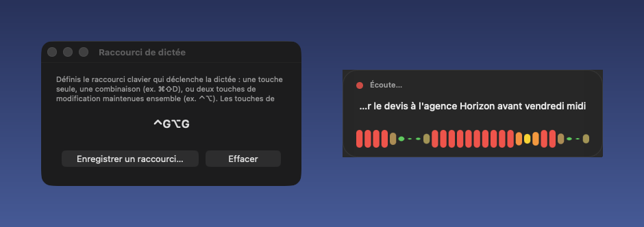

# SoTellMe

A macOS app (Dock + menu bar) to dictate text anywhere with a keyboard shortcut, with **100% local transcription** (nothing is sent to a server). It is tuned to understand software-development and gaming vocabulary.

> The UI is in French; transcription handles French and English.

## Screenshot

*Shortcut settings window and the listening HUD, with a made-up dictated sentence.*



## How it works

- Push-to-talk: hold your dictation shortcut while you speak, release it to stop.
- While the shortcut is held, a small HUD appears at the bottom of the screen with a live waveform and a preview of the transcript; it disappears as soon as you release.
- Text is **typed in real time** into the focused app while you speak. Transcription streams continuously: finished sentences are locked in and never re-decoded, only the sentence in progress is refined, so it stays fast however long you talk. If you switch apps mid-dictation, typing stops and the final text is copied to the clipboard instead.
- When you release, only the last fraction of a second is decoded once more in the background (skipped if you were silent).
- Everything runs locally with [WhisperKit](https://github.com/argmaxinc/WhisperKit) (Whisper on CoreML, accelerated by the Neural Engine on Apple Silicon).

The shortcut is configured from the menu-bar icon → **Raccourci de dictée…** (the window opens by itself on first launch): a key with modifiers (e.g. ⌘⇧D), a function key (F1–F20), or modifier keys held together (e.g. ⌃⌥). Left and right modifiers are distinguished. A bare letter/digit isn't accepted since it would also be typed in the active app. With a modifier-only shortcut, using it as part of a regular shortcut (e.g. ⌃⌥T) cancels the dictation.

The menu also shows the current state and lets you:

- start / stop dictation without the shortcut, and copy the last dictation;
- pick the microphone;
- enable **Lancer au démarrage du Mac**;
- fix missing permissions (Accessibility, Microphone) — the shortcut starts working as soon as Accessibility is granted, no relaunch needed;
- retry loading the model if it failed, open the log, restart or quit.

SoTellMe also has a Dock icon: clicking it opens the shortcut settings, and right-clicking it offers start/stop dictation and copy the last dictation.

Silent recordings are skipped (with a hint to check the microphone) and common Whisper "hallucinations" on noise are filtered out.

## Build

```bash
./build_app.sh
```

Produces `dist/SoTellMe.app` (release build + bundle + signature with a stable local identity so macOS permissions survive rebuilds).

## Installation

1. Copy `dist/SoTellMe.app` to `/Applications` (optional but recommended).
2. Open it the first time with **right-click › Open** (the app isn't notarised).
3. Grant the permissions macOS asks for:
   - **Microphone**
   - **Accessibility** — needed to type the text into other apps and to detect the global shortcut. If no prompt appears, add `SoTellMe.app` to the list yourself.
4. On first launch the app downloads the Whisper model (~500 MB–1 GB, once); after that everything works offline.

## Launch at login (optional)

Easiest: menu-bar icon → **Lancer au démarrage du Mac** (with the app in `/Applications`). Alternatively, with a LaunchAgent:

```bash
cp -R dist/SoTellMe.app /Applications/
cp LaunchAgent/com.ngoujon.sotellme.plist ~/Library/LaunchAgents/
launchctl load ~/Library/LaunchAgents/com.ngoujon.sotellme.plist
```

To disable:

```bash
launchctl unload ~/Library/LaunchAgents/com.ngoujon.sotellme.plist
rm ~/Library/LaunchAgents/com.ngoujon.sotellme.plist
```

## Technical and gaming vocabulary

A post-transcription dictionary (`Sources/SoTellMe/Resources/vocab_corrections.json`) fixes classic mistakes ("git hub" → "GitHub", "pool request" → "pull request", …). Edit it and rebuild to add your own terms.

No vocabulary prompt is given to Whisper: on the `small` model it added ~1.6 s to every decode and prevented sentence segmentation, which real-time transcription relies on.

## Whisper model

Default: `small` (multilingual). To reduce CPU / memory usage, pass `named: "base"` to `transcriber.loadModel()` in `AppDelegate.swift` (the default is set in `Transcriber.swift`).

## Project structure

```
Sources/SoTellMe/
  main.swift                         entry point, app entry point (Dock + menu bar)
  AppDelegate.swift                  orchestration (state, status item, live transcription)
  HotkeyManager.swift                global shortcut capture
  HotkeyBinding.swift                shortcut model (keys, left/right modifiers)
  HotkeySettingsWindowController.swift  shortcut recording window
  AudioRecorder.swift                microphone capture → 16 kHz mono PCM
  MicrophoneManager.swift            input device selection
  Transcriber.swift                  WhisperKit wrapper (timed segments)
  NoiseFilter.swift                  filters noise hallucinations
  VocabCorrector.swift               post-transcription corrections
  ListeningIndicator.swift           floating HUD with waveform
  TextInserter.swift                 live typing into the focused app
  Resources/vocab_corrections.json
build_app.sh                         build + bundle + sign
LaunchAgent/                         plist for launch at login (optional)
```
